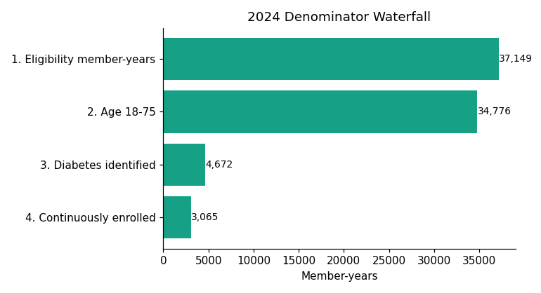
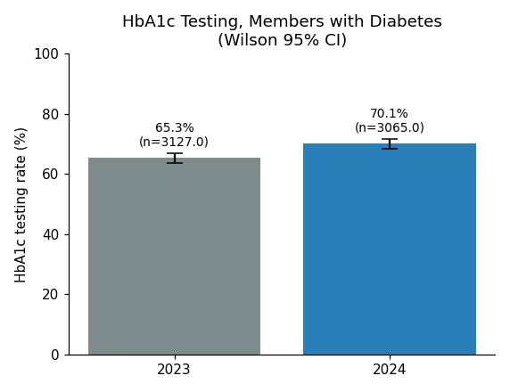
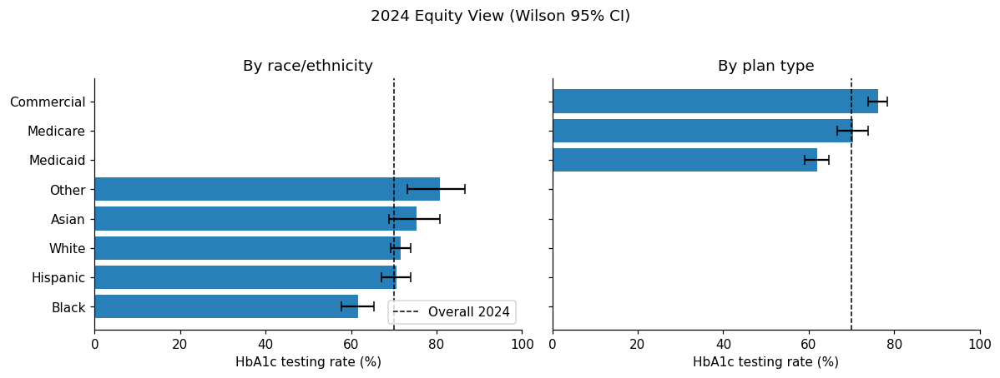
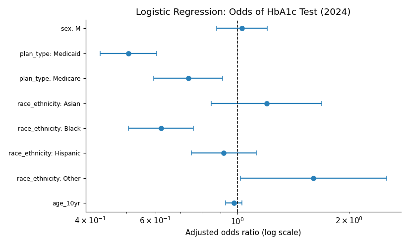
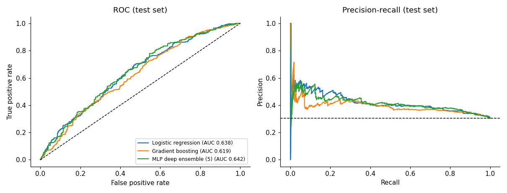
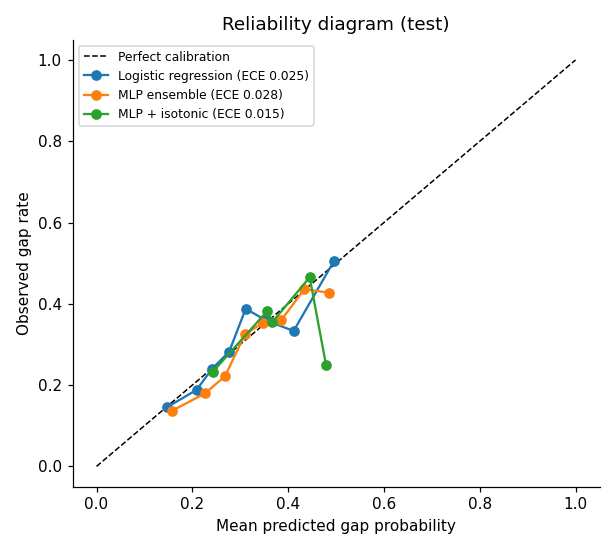
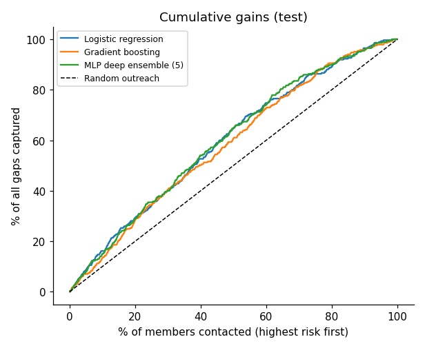
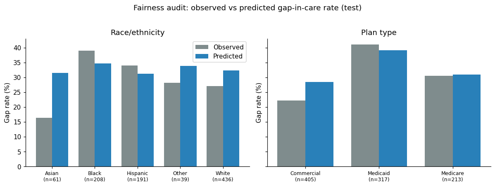
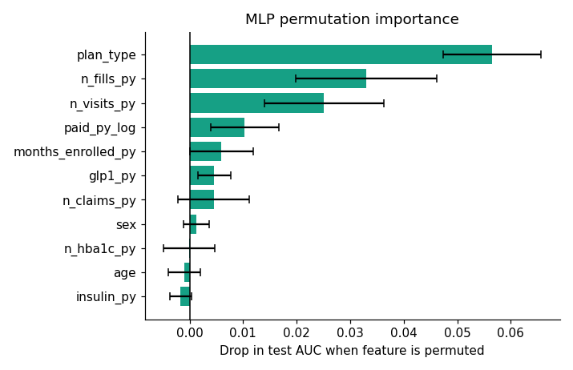

# Healthcare Quality Measure Analysis on Synthetic Claims Data

An end-to-end analytics project that calculates a HEDIS-style quality measure, **HbA1c testing for members with diabetes**, from synthetic administrative health-plan data. It covers SQL cohort building, quality control, statistical inference, an equity analysis, and a neural-network gap-in-care risk model with a fairness audit.

> **All data are synthetic.** No real patient information is used. Several effects (for example the Medicaid and race/ethnicity gaps) were built into the data generator, so the analysis recovers known patterns by design. The goal is to demonstrate the workflow and methods, not to report real-world findings.

## Contents

| File / folder | Description |
|---|---|
| `HSAG_Analyst_I_Quality_Measure_Portfolio.ipynb` | Full analysis notebook (runs in Google Colab, no setup needed) |
| `PIC/` | Static PNG figures produced by the notebook |

## Key results

| Finding | Result |
|---|---|
| HbA1c testing rate, 2023 | 65.3% (95% CI 63.6% to 67.0%) |
| HbA1c testing rate, 2024 | 70.1% (95% CI 68.4% to 71.7%) |
| Year-over-year change | +4.7 percentage points, two-proportion z-test p = 0.0001 |
| Medicaid vs Commercial (adjusted OR) | 0.51, indicating lower odds of testing |
| Black vs White members (adjusted OR) | 0.62, indicating lower odds of testing |
| Gap-in-care model | AUC about 0.62 to 0.64; contacting the top 20% by risk captures about 27% of all gaps (lift about 1.4x) |
| Neural network vs logistic regression | No significant AUC advantage for the neural network |
| Fairness audit | The model under-predicts risk for Medicaid and Black members |

The neural-network figures vary slightly between runs and machines. Check the notebook output for your exact values.

## Workflow

### 1. Source data
Four separate tables, as in real health-plan data: **eligibility** (member-year), **medical claims** (ICD-10 and CPT codes), **pharmacy claims**, and a CAHPS-style **survey**. Known defects are injected on purpose: duplicate claims, orphan claims, missing member IDs, negative payments, and impossible service dates.

### 2. SQL cohort building
Tables are loaded into SQLite. A cleaned-claims view removes the defects, and a member-year cohort is built with joins, CTEs, and aggregation.

### 3. Quality-control review
Record counts, null and duplicate checks, reasonableness ranges, frequency reviews, a denominator waterfall, and a reconciliation check that an independent pandas count equals the SQL result.

### 4. Measure specification and results

| Element | Definition |
|---|---|
| Age | 18 to 75 |
| Diabetes identification | 2 or more E11.x claims on different dates in the year, or at least one diabetes drug fill |
| Continuous enrollment | At least 11 months enrolled, no gap longer than 45 days |
| Numerator | At least one CPT 83036 claim in the measurement year |

Rates use Wilson 95% confidence intervals. The year-over-year change uses a two-proportion z-test.

### 5. Equity analysis
Rates by race/ethnicity and plan type, chi-square tests of independence, and an adjusted logistic regression reported as odds ratios with 95% confidence intervals.

### 6. Neural network for gap-in-care risk
**Question:** using only 2023 history, which diabetic members will miss their HbA1c test in 2024?

- Features come only from prior-year data, so the outcome year cannot leak into the model.
- **Race/ethnicity is excluded from the inputs** and used only to audit the model afterwards.
- Three models on the same 60/20/20 split: regularized logistic regression, histogram gradient boosting, and a **PyTorch multilayer perceptron** (BatchNorm, Dropout, AdamW weight decay, early stopping) averaged over 5 seeds as a deep ensemble.
- Evaluation: ROC-AUC with bootstrap confidence intervals, PR-AUC, Brier score, calibration curves with isotonic recalibration, cumulative gains, and permutation importance.
- Fairness audit: predicted versus observed gap rate, AUC, and error rates by race/ethnicity and plan type.

### 7. Documentation
The notebook ends with the measure specification, a data dictionary, a model card, stated assumptions and limitations, and equivalent SAS code (`PROC FREQ`, `PROC LOGISTIC`).

## Tools and methods

- **Python:** pandas, NumPy, SciPy, statsmodels, scikit-learn, PyTorch, matplotlib
- **SQL:** SQLite (joins, CTEs, aggregation, views)
- **Statistics:** Wilson confidence intervals, two-proportion z-test, chi-square test, logistic regression, bootstrap confidence intervals, permutation importance
- **Modeling:** deep ensembles, probability calibration, subgroup fairness auditing

## How to run

1. Open the notebook in [Google Colab](https://colab.research.google.com) (**File → Upload notebook**).
2. Click **Runtime → Run all**. No installs are needed.
3. Download the `PIC` folder from the Files panel if you want the figures.

The random seeds are fixed, so the measure results reproduce exactly. The neural-network results can differ slightly, especially on GPU.

## Limitations

- The data are synthetic, and the predictive signal was built into the generator, so model performance does not reflect real-world performance.
- The model evaluation uses a single random split rather than temporal validation.
- Some subgroups are small, so subgroup estimates carry wide uncertainty.
- Observed gaps in care reflect access as well as behavior, so the model should not be used for coverage or clinical decisions about an individual.
